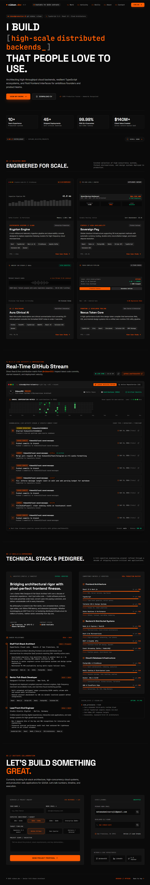

<div align="center">

# ⚡ VIDSON.DEV — Senior Full-Stack Engineer Portfolio

**Production-grade, developer-first engineering showcase and portfolio designed for high-scale architects, tech leads, and founders.**

Crafted by **[Amin Seraj (VIDSON.DEV)](https://aminseraj.eu.cc/)**

[](https://react.dev/)
[](https://www.typescriptlang.org/)
[](https://vite.dev/)
[](https://tailwindcss.com/)
[](https://motion.dev/)
[](https://t.me/MHMD_DEVVV)
[](./LICENSE)
[](https://github.com/Vidson313/vidson.dev---Senior-Full-Stack-Engineer--new-z-ai/stargazers)
[](https://github.com/Vidson313)
[](https://aminseraj.eu.cc/)

<br />

<p align="center">
  <a href="https://aminseraj.eu.cc/">
    
  </a>
</p>

[**🌐 Live Demo**](https://aminseraj.eu.cc/) • [**💬 Telegram**](https://t.me/MHMD_DEVVV) • [**💼 View GitHub Profile**](https://github.com/Vidson313) • [**📫 Email**](mailto:mohamadaminseraji1@gmail.com)

</div>

---

## 🚀 Overview

**VIDSON.DEV** is a high-performance, single-page portfolio engineered with modern front-end rigor. Designed specifically for senior engineers, distributed systems architects, and technical leaders who want an unapologetic, dev-first aesthetic that highlights measurable business impact, low-latency architectures, and deep system design capabilities.

### 🌟 Key Highlights

- **⚡ Sub-60fps Fluid Motion:** Zero-jank staggered character type-in animations powered by Motion (v12) with native `prefers-reduced-motion` compliance.
- **🛰️ Live GitHub Telemetry Stream:** Real-time event aggregator displaying commits, stars, and repository activity directly synced with the GitHub API.
- **🔬 Production Case Study Deep-Dives:** Interactive modal inspection for distributed systems, high-throughput streaming (Rust/Kafka/ClickHouse), and fintech settlement engines.
- **🎛️ Terminal Aesthetic & Developer UX:** Dark industrial interface (`#0A0A0A` background with `#FF5C00` accent), custom magnetic desktop cursor, and interactive CLI vCard copy (`npx vidson-card`).
- **📑 Dual-Format Curriculum Vitae:** In-browser printable PDF resume alongside one-click Markdown CV generation for LLM context ingestion.
- **🎯 Interactive Project Scope Estimator:** Client lead qualification form featuring dynamic budget tiers, timelines, and instant toast confirmations.

---

## 🛠️ Tech Stack & Architecture

| Layer | Technologies | Purpose |
| :--- | :--- | :--- |
| **Framework** | React 19 + TypeScript 5.8 | Strict type safety, modern hooks, and React 19 runtime |
| **Bundler** | Vite 6 | Instant HMR, optimized roll-up chunks, sub-second cold starts |
| **Styling** | Tailwind CSS v4 | Zero-runtime CSS engine, design tokens, responsive breakpoints |
| **Animations** | Motion (v12) | Hardware-accelerated staggered typography and transitions |
| **Icons** | Lucide React | Pixel-aligned, tree-shakeable developer icons |
| **Typography** | JetBrains Mono • Space Grotesk • Inter | High-contrast monospace code readability and crisp headings |

---

## 📂 Project Structure

```bash
vidson-dev-portfolio/
├── assets/                    # Presentation assets & preview screenshots
│   └── preview.png            # Full-page high-resolution showcase
├── public/                    # Static public assets
│   └── preview.png            # Social Open Graph preview image
├── src/
│   ├── components/            # Modular React 19 components
│   │   ├── ContactFooter.tsx   # Lead generation form, vCard & footer attribution
│   │   ├── CustomCursor.tsx    # Desktop custom cursor with interactive element hover
│   │   ├── CvModal.tsx         # Interactive printable resume & Markdown exporter
│   │   ├── GitHubActivity.tsx  # Live GitHub telemetry stream & commit tracker
│   │   ├── Hero.tsx            # Hero section with trust badges & dev status line
│   │   ├── Navbar.tsx          # Sticky glass navigation with scroll progress indicator
│   │   ├── ProjectModal.tsx    # Architectural deep-dive case study modal
│   │   ├── Projects.tsx        # Production project grid with metrics preview
│   │   ├── SkillsAbout.tsx     # Technical competency matrix & career timeline
│   │   ├── StaggeredHeadline.tsx # Accessible character-staggered type-in engine
│   │   └── Toast.tsx           # Global notification toast feedback
│   ├── data/
│   │   ├── githubContributions2026.json # Fallback telemetry commit cache
│   │   └── portfolioData.ts    # Centralized portfolio metrics, projects & career data
│   ├── types.ts               # Core TypeScript interfaces & contracts
│   ├── index.css              # Tailwind v4 directives, custom scrollbars & scanlines
│   ├── App.tsx                # Single-page layout orchestrator
│   └── main.tsx               # Application root mount
├── .env.example               # Environment variables template
├── .gitignore                 # Standardized Git ignore rules
├── index.html                 # SEO-optimized HTML5 shell with Open Graph & Twitter cards
├── LICENSE                    # Custom MIT License with mandatory attribution requirement
├── package.json               # Clean production scripts and verified dependencies
├── tsconfig.json              # Strict TypeScript compiler options
└── vite.config.ts             # Production Vite configuration with chunk splitting
```

---

## ⚡ Getting Started

### Prerequisites

- **Node.js**: `v20.0.0` or higher (tested with Node `v26.7.0`)
- **Package Manager**: `npm`, `pnpm`, or `yarn`

### 1. Clone the Repository

```bash
git clone https://github.com/Vidson313/vidson.dev---Senior-Full-Stack-Engineer--new-z-ai.git vidson-portfolio
cd vidson-portfolio
```

### 2. Install Dependencies

```bash
npm install
```

### 3. Start Development Server

```bash
npm run dev
```

Visit `http://localhost:3000` in your browser.

### 4. Build for Production

```bash
npm run build
```

The optimized static production bundle will be generated in the `dist/` directory.

### 5. Preview Production Build

```bash
npm run preview
```

---

## 📜 License & Mandatory Attribution Requirement

This project is licensed under a **Custom Permissive MIT License** registered to **[Amin Seraj (VIDSON.DEV)](https://github.com/Vidson313)**.

### ⚠️ Attribution Condition
You are free to fork, customize, and deploy this project for personal or portfolio use under the condition that:
> **The developer credit in the website footer (`Developed by VIDSON.DEV — Amin Seraj` linking to `https://github.com/Vidson313`) must remain intact, visible, and unmodified.**

See the complete [LICENSE](./LICENSE) file for legal details.

---

## 🌟 Support & Connect

If you find this portfolio architecture useful or inspiring:
- ⭐ **Star this repository** to support open-source development!
- 🤝 **Follow [@Vidson313](https://github.com/Vidson313)** on GitHub for updates on distributed systems and high-scale front-end projects.
- 💬 Connect with **Amin Seraj** directly via Telegram at **[@MHMD_DEVVV](https://t.me/MHMD_DEVVV)**, personal website at **[aminseraj.eu.cc](https://aminseraj.eu.cc/)**, or email at **[mohamadaminseraji1@gmail.com](mailto:mohamadaminseraji1@gmail.com)**.

<p align="center">
  <sub>Developed with craft and precision by <strong>Amin Seraj (VIDSON.DEV)</strong></sub>
</p>
